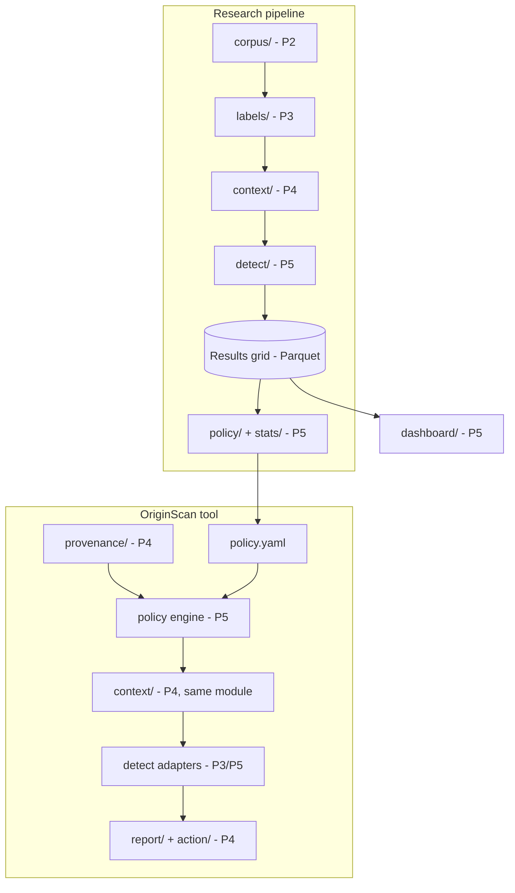
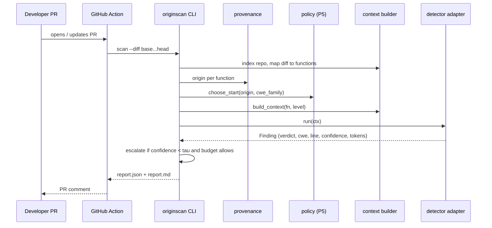

# Architecture — OriginScan P4: Context Builder & Tool

> Companion to `prd.md` and `design.md`. Describes the system shape, module boundaries, data flow, dependencies and conventions for P4's part of the OriginScan mono-repo.

## 1. System context

One Python codebase serves both the research study and the tool. P4 owns the modules marked **[P4]**; the rest are shown for integration.



Key property: `context/` and the detector adapters are **the same modules** in both halves; `policy.yaml` is the bridge.

## 2. Repository layout (P4-owned parts bolded)

Mono-repo directories from the overview: `corpus/`, `labels/`, `context/`, `detect/`, `policy/`, `stats/`, `cli/`, `action/`, `dashboard/`, `paper/`.

```
originscan/                    # repo root
├── pyproject.toml
├── config/
│   ├── context.yaml           # [P4] token caps, per-item limit, hops, ignore globs
│   └── agents.yaml            # [P4] known AI agent identities for provenance
├── src/originscan/
│   ├── interfaces.py          # [P4+P2+P5] frozen Week 1
│   ├── context/               # [P4]
│   │   ├── parser.py          #   tree-sitter extraction
│   │   ├── index.py           #   repo index + cache
│   │   ├── callgraph.py       #   approximate call graph
│   │   ├── tokens.py          #   TokenCounter implementations
│   │   ├── builders.py        #   L1/L2/L3 + build_context()
│   │   └── diff.py            #   diff → changed functions
│   ├── provenance/            # [P4]
│   │   ├── reader.py
│   │   └── git.py             #   thin git wrapper
│   ├── cli/                   # [P4]
│   │   └── main.py
│   ├── report/                # [P4]
│   │   ├── json_report.py
│   │   └── markdown_report.py
│   ├── detect/                # [P5] (+ P3 static adapter); P4 provides FakeDetector in tests
│   ├── policy/                # [P5] choose_start(), simulator, policy.yaml loader
│   ├── corpus/  labels/  stats/  dashboard/   # other owners
├── action/                    # [P4] action.yml, entrypoint, comment poster
├── .github/workflows/         # CI (tests) + example originscan workflow
├── tests/
│   ├── fixtures/              # tiny C/C++ repos and diffs
│   └── ...                    # mirrors src layout
└── docs/                      # prd.md, design.md, architecture.md, interface-changes.md
```

The overview lists top-level directories (`context/`, `cli/`, …). Placing them under `src/originscan/` is a P4 suggestion for a clean Python package; agree with the team in Week 1 before committing to it.

## 3. Module responsibilities and boundaries

| Module | Responsibility | Depends on | Must not depend on |
|---|---|---|---|
| `context.parser` | Source → `Symbol`s | tree-sitter | anything else in the repo |
| `context.index` | Repo → cached symbol index | parser | cli, report |
| `context.callgraph` | Name-based edges, hop queries | index | detect, LLM libs |
| `context.tokens` | Count tokens | tiktoken (pluggable) | — |
| `context.builders` | L1/L2/L3 assembly with caps | index, callgraph, tokens, config | detect, policy |
| `context.diff` | Diff → changed functions | index, unidiff | provenance |
| `provenance.reader` | Function → `ai/human/unknown` + evidence | git wrapper, `agents.yaml` | context.builders |
| `cli.main` | Orchestrate scan | all P4 modules, policy and detect via interfaces | — |
| `report.*` | Render JSON/Markdown | interfaces only | everything else |
| `action/` | CI wrapper; post comment | CLI, GitHub REST API | internals of context |

Rule: **`context/` has no network access and no LLM imports.** This keeps it deterministic and testable and allows P5's runner to call it safely at scale.

## 4. Data flow

### 4.1 Study path (P5's runner)
`slot_id` + `level` → `build_context()` → `Context{text, tokens, items}` → `detect()` → row in results grid (schema in overview §6.3).

### 4.2 Tool path (PR scan)


## 5. Key design decisions

| # | Decision | Rationale | Trade-off |
|---|---|---|---|
| D1 | tree-sitter for parsing, no compiler/build system | Works on any repo without building; multi-language later | No semantic resolution; call graph approximate |
| D2 | Name-based call graph with explicit ambiguity rule | Cheap, deterministic, explainable | Misses pointers/macros/overloads |
| D3 | Selected, priority-ordered context under hard caps | Dumped context can hurt (CPRVul, Lira et al.) | Ranking heuristic is a research variable |
| D4 | Pluggable `TokenCounter`; default tiktoken approximation | Different models tokenise differently | Caps are approximate until tuned per model |
| D5 | Detector access through adapter interface + `FakeDetector` | P4 can finish and test without P5/P3 or API keys | Integration risk deferred; mitigate with Week 5–6 integration tests |
| D6 | Index cached per commit hash | L3 builds fast; supports "cache L3 contexts" cost saving | Cache invalidation must key on commit + config hash |
| D7 | Config in YAML, hashed into each run's metadata | Reproducibility ("every number traces to a script, config and run log") | More files to manage |
| D8 | Provenance trusts metadata only, `unknown` is a first-class value | OriginScan is explicitly not an AI-code detector | Many real PRs will be `unknown` |
| D9 | Reports share one internal result model rendered to JSON and Markdown | Single source of truth | Slightly more upfront modelling |

## 6. Technology stack (P4)

| Layer | Choice | Source |
|---|---|---|
| Language | Python 3.11 | Overview §6.4 |
| Parsing | tree-sitter (`tree-sitter`, `tree-sitter-c`, `tree-sitter-cpp`) | Overview §6.4 |
| CLI | Typer (or Click) | Overview §6.1 |
| CI / Action | GitHub Actions | Overview §6.4 |
| Storage | Parquet for results (P5); JSON/SQLite for the P4 index cache | Parquet from overview; index format is P4's choice |
| Packaging | Docker image for the full pipeline (P2 owns) | Overview §6.4 |
| Tokens | tiktoken (default) | P4 proposal |
| Diff | `unidiff` | P4 proposal |
| Quality | pytest, mypy, ruff | P4 proposal |

Check exact package names and versions on PyPI when setting up; tree-sitter's Python bindings have changed API between releases, so pin versions in `pyproject.toml` and note them in the run log.

## 7. Configuration

| File | Owner | Contents |
|---|---|---|
| `config/context.yaml` | P4 (P5 consulted) | Token caps, per-item limit, hop depth, ignore globs, tokenizer name |
| `config/agents.yaml` | P4 | Known agent bot accounts, trailer keys |
| `policy.yaml` | P5 | Start level per origin (optionally per CWE family), τ, λ |
| `.env` / secrets | each user | LLM API keys (never committed) |

Every run writes: run ID, git commit, config hashes, tokenizer name, model IDs, dates (per working agreements).

## 8. Quality attributes

| Attribute | Approach |
|---|---|
| Determinism | Stable ordering, no randomness, hash-keyed caches; test runs twice and compares |
| Reproducibility | Config + commit + tokenizer recorded per run; Docker via P2 |
| Robustness | Parse errors degrade, never crash; per-file try/except with logging |
| Performance | Index once per commit; L3 from cache; target measured in Week 3–5 |
| Security | Secrets via env/Actions secrets; no key logging; scans only repos we own; no exploit code |
| Testability | Pure functions, fixtures, `FakeDetector`, golden files |

## 9. Integration contracts and schedule

| Contract | With | When |
|---|---|---|
| `interfaces.py` (Context, Finding, build_context, detect, choose_start) | P2, P5 | Frozen Week 1, Day 5 |
| `build_context` + `detect` integrated | P5 | Weeks 3–5 (builder ready Week 5) |
| Repo snapshots / slot IDs | P2 | Week 3 onward |
| `policy.yaml` loaded by CLI | P5 | Weeks 10–11 |
| Static adapter (Semgrep/CodeQL) in tool | P3 | Weeks 11–12 |

Process: all code via pull requests with one reviewer from another workstream; twice-weekly stand-ups; weekly demo.

## 9.1 Fallbacks if a dependency is late

- No `detect()` yet → `FakeDetector`.
- No `policy.yaml` yet → confidence-only default starting at L1.
- No benchmark repos yet → 3 public C repos in `tests/fixtures` or as submodules.
- L3 not ready by Week 5 → ship L1 + L2 first; L3 follows.

## 10. Known limitations to surface in docs and reports

- Call graph is approximate (pointers, macros, same-named statics, C++ overloads/virtuals).
- Heavy preprocessor use can hide symbols.
- Token counts are approximations of the target model's tokenizer.
- Provenance only works when metadata exists.
- Research prototype, not production software.

## 11. Open architecture questions

1. `src/originscan/` layout vs top-level directories — agree with team (Week 1).
2. Index cache format: JSON vs SQLite (default: SQLite if index > a few MB).
3. Final token caps per level — decide with P5 after the Week 1 pilot.
4. Whether CodeMentor tree-sitter code is reusable (assume no).
5. Whether the Action is a composite action or a Docker action (depends on P2's Docker image).

## 12. Using these docs in Antigravity

- Put `prd.md`, `design.md`, `architecture.md` in `docs/` (or the repo root) and point the agent at all three.
- First prompt suggestion: *"Read docs/prd.md, docs/design.md and docs/architecture.md. Implement Phase 1 tasks 1.1 to 1.5 from prd.md section 7 only: repo skeleton, `interfaces.py`, config loading, CI. Stop and summarise when tests pass."*
- Then proceed one phase (or a few tasks of a phase) per prompt, requiring tests to pass before moving on.
